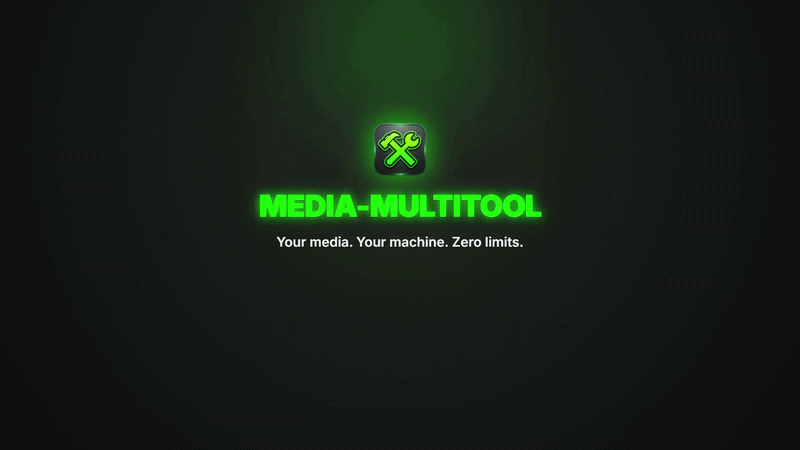

<p align="center">
  <a href="https://github.com/Jussi699/media-multitool/releases/latest">
    
  </a>
</p>
<h1 align="center">Media-Multitool</h1>
<p align="center">
  <b>Stop uploading private files to sketchy converter websites.</b><br>
  Media-Multitool converts, compresses, and edits video, audio, images, and PDFs 100% locally on your machine — zero tracking, completely offline, and free forever.
</p>

<p align="center">
  <a href="https://www.oracle.com/java/technologies/downloads/"></a>
  <a href="https://gluonhq.com/products/javafx/"></a>
  <a href="https://ffmpeg.org/download.html"></a>
  <a href="https://maven.apache.org/download.cgi"></a>
  <a href="LICENSE"></a>
</p>
<p align="center">
  <a href="https://github.com/Jussi699/media-multitool/releases/latest">
    
  </a>
</p>
<p align="center">
  <a href="https://github.com/Jussi699/media-multitool/releases/latest">
    
  </a>
</p>

## Overview

### 🖼️ Image Conversion
- **Supported Formats:** PNG, JPEG, WEBP, TIFF, BMP, ICO, SVG, PPM, PGM, PAM
- **ICO Support:** Full support for reading and writing `.ico` files with custom sizing (16x16 to 768x768)
- **WebP Support:** Efficient conversion to and from the WebP format
- **Batch Processing:** Convert multiple images at once
- **Smart Resizing:** High-quality interpolation and anti-aliasing
- **Transparency Handling:** Automatically converts transparent backgrounds to white when converting to JPEG

### 🎥 Video & Audio Conversion
- **Powered by JAVE2 (FFmpeg):** Reliable and fast conversion using industrial-grade codecs
- **Video Formats:** MP4, AVI, MKV, WEBM, MOV, FLV, WMV, 3GP
- **Audio Formats:** MP3, AAC, OGG (Vorbis), OPUS, FLAC, ALAC (M4A), WAV, AIFF
- **Video Settings:**
  - Bitrate control (1000-8000+ kbps)
  - Frame rate (FPS) adjustment
  - Resolution scaling with aspect ratio preservation
  - GPU acceleration support
  - Codec selection (H.264, etc.)
- **Audio Settings:**
  - Bitrate (128-320 kbps)
  - Sampling rate (8000-48000 Hz)
  - Channel selection (Mono/Stereo)
  - Lossy/Lossless compression options
- **Asynchronous Processing:** Background conversions with responsive UI
- **Cancellation Support:** Stop conversions anytime with automatic cleanup

### 🗜️ Media Compression
#### Image Compression
- **Formats:** JPG, PNG, WEBP, TIFF, BMP, and more
- **Quality Control:** 5%-100% quality settings
- **Scale Options:** 5%-100% size reduction
- **Live Preview:** See compressed result before saving
- **Smart Compression:** Skips compression if file would be larger

#### Video Compression
- **Adaptive Presets:** Basic, Strong, and Super compression levels
- **Audio Compression:** Optional audio track compression
- **GPU Acceleration:** Hardware encoding support
- **Size Estimation:** Preview estimated output file size

### 🎨 Image Tools
- **Black & White:** Convert images to grayscale
- **Blur:** Apply gaussian blur with adjustable intensity
- **Spot Blur:** Apply Gaussian blur with adjustable intensity and the ability to select your own custom blur zones
- **Colorize:** Apply color tint with custom color picker
- **Color Replace:** Replace specific colors or all colors with smoothing/enhancement
- **Crop:** Interactive cropping with 14 aspect ratio presets (1:1, 16:9, 9:16, 4:5, 3:4, etc.)
- **Darken/Lighten:** Adjust image brightness with real-time preview
- **Find Pixel:** Click to get RGB/HEX color values at any pixel
- **Negative:** Invert image colors
- **Turn/Flip:** Rotate (left/right) and flip (horizontal/vertical)

### 📄 PDF Tools
- **Compress PDF:** Reduce file size with Low/Medium/High compression levels
- **Convert Image to PDF:** Single image to PDF with page size/orientation/margin options
- **Convert Images to PDF:** Merge multiple images into one PDF
- **Convert PDF to Images:** Extract all pages as PNG/JPEG/WEBP/TIFF/BMP/PPM/PGM/PAM
- **Merge PDFs:** Combine multiple PDFs with drag-and-drop page ordering
- **Split PDF:** Extract pages by range or select individual pages
- **Protect PDF:** Add password protection (owner and user passwords)
- **Unlock PDF:** Remove password protection from encrypted PDFs
- **Remove Pages:** Delete specific pages from PDF with visual preview

### 🎵 Media Tag Editor
- **Type-aware Metadata Editing:** Available tag fields vary by audio, photo, or video; unsupported fields are locked and marked
- **Audio Metadata:** Title, Artist, Album, Album Artist, Composer, Genre, Year, Track, Disc Number, Comment
- **Photo Metadata:** Title, Artist, Comment, Description, Keywords, Copyright, Rating (JPEG and TIFF files)
- **Video Metadata:** Title, Artist, Album, Album Artist, Composer, Genre, Year, Track, Disc Number, Comment, Description, Keywords, Copyright, Rating
- **Photo tags:** Edited with Apache Commons Imaging; video tags are written through FFmpeg using stream copy without re-encoding.
- **Cover Art:** View, change, or remove album artwork
- **Batch Editing:** Edit multiple audio files at once
- **Search/Filter:** Find files in loaded batch by filename or metadata
- **Format Support:** MP3, AAC, OGG, OPUS, FLAC, M4A, WAV, AIFF

### 🎨 User Interface
- **Modern JavaFX GUI:** Clean, intuitive interface with dark theme
- **Drag & Drop:** Simply drag files into any tool to start
- **Real-time Preview:** Live preview for image tools and PDF operations
- **Progress Tracking:** Real-time progress bars for all operations
- **Detailed Logging:** Built-in logging for troubleshooting and monitoring

## 🔒 Privacy & Transparency

Media Multitool processes your media files locally on your computer. We take your privacy seriously:

- **No telemetry:** The application code contains no analytics or telemetry collection.
- **Local processing:** Image, audio, video, and PDF operations run on your device; files are not uploaded to a processing service.
- **No automatic network requests:** The application does not make network requests for processing or update checks. Links such as GitHub and GPS map links open externally only when you choose to visit them.
- **Open source:** The project is available under the MIT License, so its code can be inspected and audited.

## 🛠️ Tech Stack

- **Java 25** (OpenJDK)
- **JavaFX 25/21** (GUI Framework)
- **Maven** (Build Tool)
- **JAVE2** (FFmpeg wrapper for video/audio encoding)
- **Apache PDFBox** (PDF manipulation and rendering)
- **JAudioTagger** (Audio metadata editing)
- **Image4j** (ICO format support)
- **TwelveMonkeys & Sejda ImageIO** (Advanced image format support including WebP)
- **Lombok** (Code generation)
- **Logback & SLF4J** (Logging)

## 📋 Prerequisites

> [!IMPORTANT]
> **Java Runtime Environment (JRE) is required** to run the packaged application.
- **For users:**
  - Download and run the application from [Latest Release](https://github.com/Jussi699/media-multitool/releases/latest).
  - Install Java Runtime: [Download JDK 25](https://www.oracle.com/java/technologies/downloads/) or [Download Eclipse Temurin JRE/JDK](https://adoptium.net/temurin/releases/).
- **For developers:**
  - [Java Development Kit (JDK) 25+](https://www.oracle.com/java/technologies/downloads/)
  - [Apache Maven 3.8+](https://maven.apache.org/download.cgi)

## 📥 Installation & Running
 <a href="https://github.com/Jussi699/media-multitool/releases/latest">
    
 </a>

---

#### 1. Clone the repository
```bash
git clone https://github.com/Jussi699/media-multitool.git
cd media-multitool
```

#### 2. Build the project
```bash
mvn clean install
```

#### 3. Run the application
```bash
mvn javafx:run
```

---

### 💡 Running in IntelliJ IDEA

> Make sure the following are configured before building:

**Enable annotation processing:**
`File` → `Settings` → `Build, Execution, Deployment` → `Compiler` → `Annotation Processors` → check **Enable annotation processing**

**Activate the Lombok plugin:**
`File` → `Settings` → `Plugins` → search for **Lombok** → install and enable it → restart the IDE

After that, open the project, let Maven sync finish, then run via `mvn javafx:run` or use the built-in Maven panel on the right.
   
## 📄 License

This project is licensed under the MIT License - see the [LICENSE](LICENSE) file for details.

---
Developed by [Jussi669](https://github.com/Jussi699)
